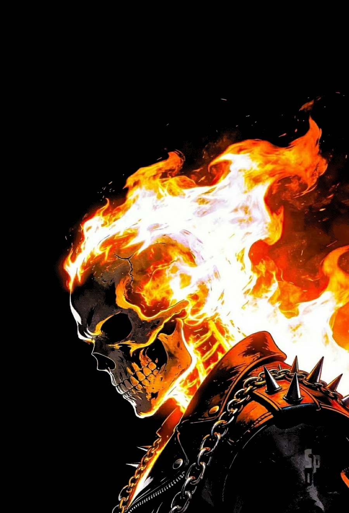

<div align="center">

# 🎨 DTF Halftone Studio

**DTF prepress in the browser — soft knockout, levels, fade halftone, white underbase, print check, and a shirt-size guide. No install, no server, nothing uploaded.**


</div>

<p align="center">
  
  <br>
  <em>Converted with <code>halftone-studio.html</code>: the black background is knocked out, so only the color and the halftone dots print (shown here on black).</em>
</p>

## Two apps

| App | What it is |
| --- | --- |
| **`halftone-studio.html`** | The main tool. One HTML file — download it and double-click to open. |
| **`DTF App/DTF-TONES-Studio.html`** | TONES Studio — a faster GPU (WebGL2) version with knockout, cleanup, print-size rendering and a separate underbase. Also one file; source is in `DTF App/`. |

Do **not** open them in Google Drive preview — Drive won't run them.

## What halftone-studio.html does

Drop in your artwork and get a print-ready DTF file: the background is knocked out, the fades turn into halftone dots, and a white underbase is generated — all in the browser, at 300 DPI, with every export tagged 300 DPI + sRGB.

- 🎯 **Soft knockout** — two-zone: Drop range + Fade width, measured per channel so saturated dark reds and blues are protected; click the preview to sample the color (eyedropper), with a Match garment button
- 🎚️ **Levels** — black / gray / white before the halftone, with Neutral, DTF fades (7 / 2.0 / 100), and Auto presets
- 🔘 **Halftone screen** — round / ellipse / square / diamond / line dots, LPI and angle controls, dot-gain compensation, smallest dot in mm (grow or drop) with stray-speck cleanup, Solid above, edge protection
- ✨ **Fades & shadows mode** — solid areas stay solid; dots appear only where the art fades into the shirt (the RIP screens photographic tone itself)
- 👕 **Shirt-size guide** — pick a size (Youth S–L, Adult XS–5XL) and placement (full front / full back / left chest) and it sets the print width to the recommended size; drag the slider any time to use your own size, and **Edit sizes** lets you change the guide itself (saved in the browser)
- 📏 **Effective-DPI warning** — green ≥ 300, amber 150–299, red < 150, with the true 300-DPI print size; reads the file's DPI tag (PNG, JPEG JFIF or EXIF) on import and warns if it's a 72/96 screen default
- ⬜ **White underbase** — built from the actual ink dots, choked only at the outer edge (exact distance transform), with Protect thin lines and No white under blacks; exported as a separate transparent PNG
- 🏷️ **Real 300 DPI** — the art is resampled to print width × 300 px and tagged 300 DPI + sRGB, so the RIP opens it at the right size
- ✅ **Print check + test wedge** — runs a full 300-DPI check (dots, dots with no white, thin lines) and exports a printable LPI × coverage wedge to calibrate your shop's settings; Garment lineup and Print problems views show the result on six shirt colors

### Quick start

1. Drop an image in (or click to browse)
2. Pick a shirt size and placement, or set the print width yourself
3. Tune the halftone screen and knockout to taste
4. Export the color halftone and the underbase — both transparent PNGs at 300 DPI, ready for the RIP

Defaults (v6): LPI 35, angle 22.5°, dot gain 0% (0–10%), Drop range 30, Fade width 60, levels 0 / 1.0 / 255, Solid above 85%, smallest dot 0.45 mm (grow), edge protection 3 px, underbase choke 2 px (outer edge only), halftone mode "Fades & shadows".

> **About DPI:** "300 DPI" only means real detail if the source has enough pixels. A 1080 px wide image printed 10 in wide has 108 DPI of real detail — the app upscales it to 3000 px and warns you. For a sharp print, use a source at least print width × 300 px wide, or print smaller.

## TONES Studio (`DTF App/`)

Open `DTF App/DTF-TONES-Studio.html` directly, or build it from source (Vite + TypeScript):

```bash
cd "DTF App"
npm install
npm run dev      # develop
npm run build    # produces dist/index.html (one ~44 KB file)
cp dist/index.html DTF-TONES-Studio.html
```

- Set the print **Width / Height** (in, cm or mm) under Image Size; the app renders at that size × 300 px and warns about low DPI, upscaling and film width.
- **Export** saves the color PNG with real transparency; turn on **Underbase** to also save a separate, choked white PNG.
- **Background removal:** for solid black or white backgrounds use the Knockout controls. For photo backgrounds, click **Open background remover ↗** (opens remove.bg in a pop-up — it uploads the image to their servers; change `BG_REMOVER_URL` in `src/main.ts` to use another site), download the transparent PNG, and drop it in.

## Notes

- The RIP (AcroRIP / CADlink / EKPrint / MainTOP / Flexi) generates the white underbase from the PNG's transparency and does its own screening. The halftone here is for fades into the shirt, a vintage look, or lightening a heavy print — not for the whole photo. Export one transparent PNG, sRGB, 300 DPI at exact print size, unmirrored.
- The example image is fan artwork used only to demonstrate the conversion; it is not for sale.
